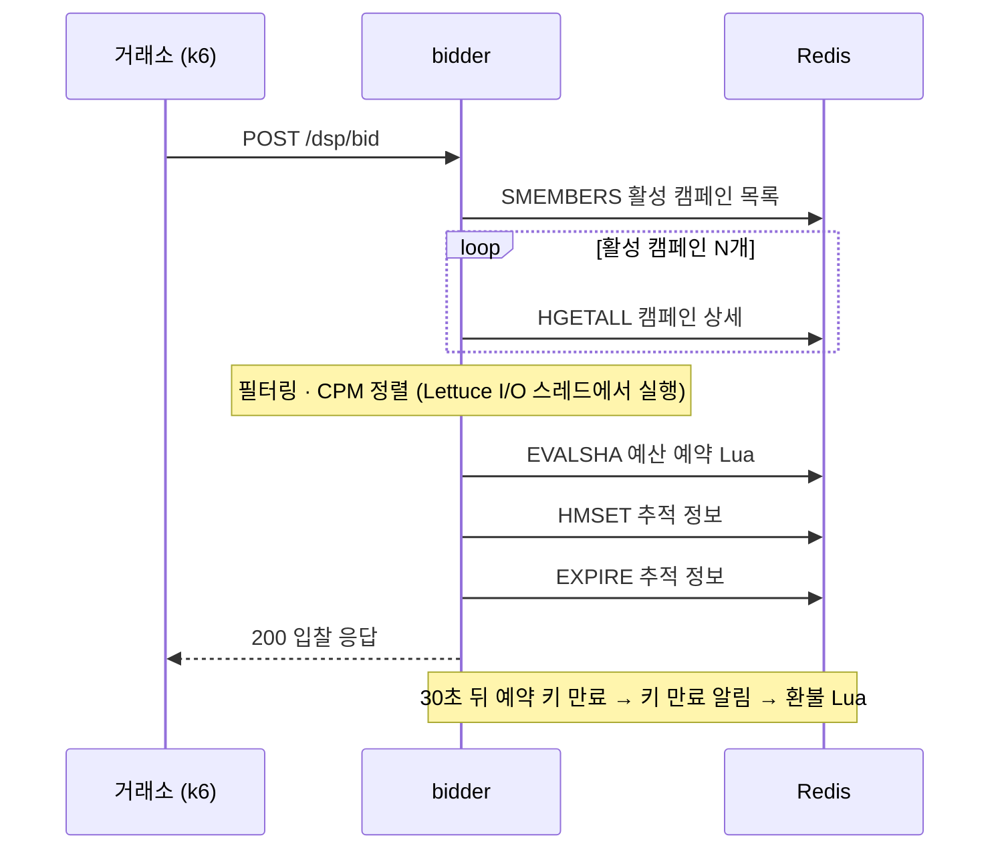

# 성능 검증

`bidder`의 입찰 경로를 대상으로 예산 정합성, 처리 용량과 병목, 한계를 넘었을 때의 동작을 측정했습니다. 측정은 로컬 노트북의 Docker Compose 환경에서 했습니다. 그래서 수치는 운영 환경의 절대 성능이 아니라, **같은 조건에서 반복해 재현되는 값**과 **병목의 구조**를 보여주는 근거로 읽어야 합니다.

## 요약

| 항목 | 결과 |
| --- | --- |
| 예산 정합성 | 동시 최대 2,000 req/s 조건까지 9회 측정. 예약 75,300건 중 **초과 예약 0건**, 최종 잔액이 기대값과 모두 일치 |
| 처리 한계 (p99 ≤ 100ms) | 활성 캠페인 10 / 100 / 1,000개에서 **750 / 200 / 18 req/s** (3회 모두 통과한 최대 요청률) |
| 병목 | 요청마다 활성 캠페인 전체를 Redis에서 조회(`HGETALL` N회)하고, 그 응답 처리가 **Lettuce I/O 스레드 하나**에 몰림. 캠페인 100개 이상에서는 한계 근처에서 이 스레드가 bidder 스레드 CPU의 90% 이상을 쓰는 동안 Redis는 0.2~0.3코어로 여유 |
| 한계를 넘었을 때 | 요청 타임아웃과 부하 차단이 없어 대기열이 쌓이고 p50이 수 초까지 늘어나며, 처리량도 목표에 못 미침 |
| 지속 부하 | 만료 환불이 입찰 속도를 따라가지 못해 **미환불 예약이 계속 증가**. 그동안 그 예산은 다른 입찰에 쓰이지 못함 |

## 검증 환경과 방법

| 항목 | 내용 |
| --- | --- |
| 대상 | `bidder`의 `POST /dsp/bid`, `/dsp/win`과 만료 환불 경로. 전체 서비스(Redis, Kafka, Schema Registry, PostgreSQL, `ad_manager`, `log-consumer`)를 함께 띄움 |
| 리소스 제한 | bidder 2 vCPU / 1 GiB, 힙 512 MiB 고정, G1 GC. Redis 1 vCPU / 512 MiB, Kafka 2 vCPU 등 ([`perf/docker-compose.perf.yml`](perf/docker-compose.perf.yml)) |
| 부하 모델 | k6 `constant-arrival-rate`(요청률 고정, 개방형 모델). 실제 거래소처럼 서버가 느려져도 같은 속도로 요청을 보냄. VU 수를 고정하는 방식은 서버가 느려질 때 요청을 덜 보내 지연이 실제보다 좋게 나오므로 쓰지 않음 |
| SLA | p99 ≤ 100ms(입찰 응답 제한으로 흔히 쓰는 값), 드롭 1% 미만, 에러 0 |
| 판정 | 같은 조건을 3회 반복하고, **3회 모두 SLA를 통과한 가장 높은 요청률**을 기준값으로 삼음 |
| 시드 | 모든 캠페인이 입찰 후보가 되도록 타겟을 요청과 일치시킨 최악 조건. 예산은 측정 중 소진되지 않을 만큼 크게 |
| 낙찰 | 처리 용량 측정에서는 win 호출 없음. 실제 RTB처럼 입찰 대부분이 낙찰되지 않는 조건이라, 입찰 1건마다 30초 뒤 만료 환불 1건이 따라붙음 |
| 고정 설정 | 트레이싱 샘플링 100%, Kafka 메시지마다 INFO 로그. 기준선의 일부로 포함 |

**측정 환경의 일관성.** 처리 용량은 Apple M4 MacBook Air(팬 없음)에서 **저전력 모드**로 측정했습니다. 일반 모드에서는 부하가 2~6분 이어지면 macOS 발열 상태가 올라가고, 같은 일에 드는 CPU가 20~25% 늘어 회차마다 결과가 흔들렸습니다(원본 zip의 `archive-pc2-attempt2/`). 저전력 모드로 CPU 속도를 낮게 고정하자 측정 내내 발열 상태가 정상으로 유지됐습니다. 회차 간 요청당 CPU 편차도 ±1~2.5%로 줄었습니다. 그 대가로 절대 처리량은 일반 모드의 약 절반입니다(단일 스레드 속도 1.92배 차이). 측정 전에는 발열 상태와 단일 스레드 속도가 유휴 기준값으로 돌아왔는지 확인했고, 회차 사이에 8분씩 쉬었습니다.

## 1. 예산 정합성

**질문:** 입찰이 동시에 몰려도 Redis Lua 기반 예약·확정·환불이 예산을 정확히 지키는가?

**방법**
1. 캠페인 1개를 작은 예산으로 시드합니다(1회 예약액 1원, 용량 = 예산 ÷ 1원).
2. 예약 TTL(30초)보다 짧은 20초 동안, 용량보다 훨씬 많은 입찰을 고정 요청률로 보냅니다. TTL보다 짧아야 만료 환불된 예산이 다시 쓰이지 않아 "성공 입찰 수 ≤ 용량"으로 판정할 수 있습니다.
3. 성공한 입찰의 절반에 win을 호출해 확정 경로와 만료 환불 경로를 함께 태웁니다.
4. 예약이 모두 정리된 뒤 Redis의 잔액과 예약 키를 검사합니다.

**결과** (3개 조건 × 3회, 모두 통과)

| 조건 | 입찰 요청 | 예약 성공 | 확정 | 만료 환불 | 판정 |
| --- | ---: | ---: | ---: | ---: | :---: |
| 500 req/s, 용량 100회 (경합 약 0.2초) | 30,002 | 300 | 149 | 151 | 3/3 |
| 500 req/s, 용량 5,000회 (경합 약 10초) | 30,002 | 15,000 | 7,473 | 7,527 | 3/3 |
| 2,000 req/s, 용량 20,000회 (bidder 포화 상태) | 80,629 | 60,000 | 29,916 | 30,084 | 3/3 |

입찰 요청부터 만료 환불까지는 3회 합계입니다.

- 9회 모두 예약 성공 수가 용량과 정확히 같았습니다. 예산을 남기지도 넘기지도 않았습니다.
- 모든 회차에서 `최종 잔액 = 초기 예산 − 확정 금액`이 일치했고, 남은 예약 키는 0개였습니다. 확정된 예약이 환불되거나 두 번 환불된 경우가 없습니다.
- bidder가 포화돼 요청이 1초 넘게 대기열에 머무는(p50 1.3~1.7초, 드롭 7,856~18,571건) 2,000 req/s 조건에서도 결과가 같았습니다. Lua 스크립트가 잔액 확인·차감·예약 기록을 한 번에 실행하므로, 처리 순서나 지연과 무관하게 정합성이 유지됩니다.
- Kafka를 거쳐 저장된 `bidding_log` 행 수는 예약 성공 수와, `win_log` 행 수는 확정 수와 일치했습니다.

이 시나리오는 CPU 속도와 무관한 정합성 판정이라 일반 모드에서 측정했습니다. 단일 bidder 인스턴스와 단일 Redis 기준이며, bidder가 내려간 동안 만료 알림을 놓치는 장애는 유도하지 않았습니다.

## 2. 처리 용량과 병목

**질문:** p99 ≤ 100ms를 지키는 처리 용량은 얼마이고, 활성 캠페인 수에 따라 어떻게 변하며, 무엇이 한계를 정하는가?

**방법:** 요청률을 단계적으로 올리며 단계마다 60초씩 측정합니다. 단계마다 Redis 명령 통계를 초기화하고, bidder 스레드별 CPU(`/proc`)와 Redis CPU를 함께 수집합니다.

### 결과

| 활성 캠페인 | 기준 처리량 (3/3 통과) | 그 위 단계 | 낮은 부하의 p50 | 요청 1건당 Lettuce 스레드 CPU |
| ---: | ---: | --- | ---: | ---: |
| 10 | **750 req/s** | 875: 2/3 통과, 1,000: 0/3 | 약 1.3 ms | 0.75 ms |
| 100 | **200 req/s** | 225: 3회 모두 포화 | 약 5.5 ms | 4.5 ms |
| 1,000 | **18 req/s** | 21: 3회 모두 포화 | 약 50 ms | 47 ms |

- 캠페인 100개 이상에서는 활성 캠페인 수가 10배가 되면 처리 한계가 약 1/10이 됩니다(200 → 18 req/s). 10개에서 100개로 갈 때는 약 1/4(750 → 200 req/s)에 그치는데, 캠페인 10개에서는 조회 외 비용이 한계를 정하기 때문입니다(아래 "병목" 참고). 캠페인 1,000개에서는 부하가 거의 없어도 p50이 약 50ms로, 응답 제한의 절반을 캠페인 조회에 씁니다.

### 요청 1건의 Redis 작업



| 구분 | 명령 | 요청당 | 네트워크 왕복 |
| --- | --- | ---: | :---: |
| 활성 캠페인 목록 | `SMEMBERS` | 1 | 1회 |
| 캠페인 상세 | `HGETALL` | **N** | N회 |
| 예산 예약 | `EVALSHA` + Lua 내부 명령 6개 | 7 | 1회 |
| 추적 정보 저장 | `HMSET`, `EXPIRE` | 2 | 2회 |
| 만료 환불 (리스너) | `EVALSHA` + Lua 내부 명령 5개 | 6 × 환불 비율 | 별도 |

실측 요청당 명령 수는 캠페인 10 / 100 / 1,000개에서 약 23 / 114 / 1,014개로 `N + 10 + 환불분`과 일치합니다. `HGETALL`은 모든 단계에서 요청당 정확히 N회였습니다.

### 병목: Redis가 아니라 bidder의 Lettuce I/O 스레드 하나

| 근거 | 캠페인 100개, 175 req/s | 캠페인 1,000개, 18 req/s |
| --- | --- | --- |
| Lettuce I/O 스레드 1개의 CPU | 0.80코어 (bidder 스레드 합계의 90%) | 0.84코어 (94%) |
| Redis CPU | 0.19코어 | 0.31코어 |
| 이론 한계 (1초 ÷ 요청당 Lettuce CPU) | 약 220 req/s | 약 21 req/s |
| 실측 기준값 | 200 req/s (이론의 91%) | 18 req/s (85%) |

- 공유 Redis 연결의 응답은 Lettuce 이벤트 루프 한 스레드가 처리합니다. 캠페인 조회 체인에 스레드 전환(`publishOn`)이 없어서, 응답 해석·`collectMap`·도메인 변환(`LocalDateTime.parse`, 요청마다 새로 만드는 `DateTimeFormatter`)·정렬이 모두 그 스레드에서 실행됩니다.
- 그 결과 bidder에 2 vCPU를 할당해도 실질 처리 능력은 1코어로 제한됩니다.
- 요청당 Lettuce CPU로 계산한 이론 한계가 실측과 맞습니다. 즉 처리 한계를 측정 전에 예측할 수 있고, 이것이 병목을 정확히 짚었다는 근거입니다.

캠페인이 적은 경우(10개)에는 조회 비용이 작아 Lettuce 스레드(750 req/s에서 bidder 스레드 합계의 66%)보다 bidder 전체 CPU가 먼저 한계에 닿습니다. 1,000 req/s에서 bidder CPU가 할당량의 85%(2 vCPU 중 1.7)에 달했습니다. 이때는 HTTP 처리, Kafka 발행, 메시지마다 남기는 로그, 만료 환불 같은 조회 외 비용이 다음 병목입니다.

## 3. 한계를 넘었을 때

| 조건 | 목표 | 실제 처리 | p50 | 상태 |
| --- | ---: | ---: | ---: | --- |
| 캠페인 100개 | 225 req/s | 166~168 req/s | 6.3초 | 대기열 누적 |
| 캠페인 1,000개 | 21 req/s | 17.9~18.5 req/s | 5.6~7.5초 | 대기열 누적 |

요청 타임아웃, 부하 차단, 대기열 상한이 없습니다. 그래서 처리하지 못한 요청이 대기열에 계속 쌓입니다. 거래소는 100ms가 지나면 응답을 포기하지만 bidder는 이미 버려진 요청까지 끝까지 처리합니다. 한계를 조금만 넘어도 정상 범위의 요청까지 함께 느려집니다.

## 4. 지속 부하에서 드러난 환불 경로 문제

60초 단계 측정에서는 입찰 30초 뒤 시작되는 만료 환불의 대부분이 다음 단계나 단계 사이로 밀려, 환불 비용이 거의 반영되지 않습니다. 그래서 같은 요청률을 10분 동안 유지하며 Redis의 예약 상태를 분마다 확인했습니다(캠페인 10개, 요청률당 1회, 참고 측정).

| 요청률 | 판정 | 10분 중 최악 p99 | 미환불 예약 (1분째 → 10분째) | TTL 30초 기준 기대값 |
| ---: | :---: | ---: | --- | ---: |
| 400 req/s | 통과 | 3.4 ms | 21,807 → 52,856 | 약 12,000 |
| 450 req/s | 통과 | 5.1 ms | 24,101 → 61,982 | 약 13,500 |
| 500 req/s | 통과 | 5.0 ms | 27,034 → 67,183 | 약 15,000 |
| 550 req/s | 통과 | 20.1 ms | 30,223 → 76,691 | 약 16,500 |
| 600 req/s | 통과 | 28.6 ms | 33,605 → 84,626 | 약 18,000 |
| 650 req/s | 통과 | 59.8 ms | 36,547 → 91,847 | 약 19,500 |
| 700 req/s | 통과 | 42.3 ms | 39,478 → 98,857 | 약 21,000 |
| 750 req/s | 실패 | 232 ms (1분째만, 2~10분째 최대 79.7 ms) | 41,949 → 107,835 | 약 22,500 |

750 req/s는 워밍업 요청률(150 req/s)에서 한 번에 5배로 올린 첫 1분만 SLA를 넘었습니다. 지속 측정에 서서히 올리는 구간이 없어서 생긴 것으로, 6절 측정의 한계에 적었습니다.

- 지연은 SLA 안이지만, **미환불 예약이 멈추지 않고 늘어납니다.** 400 req/s에서 10분째에는 기대값의 4배 이상이었습니다. 일반 모드에서 1,000 req/s를 20분 유지한 측정에서는 부하를 멈춘 뒤에도 10분 넘게 환불이 이어졌습니다(분당 환불 2만 8천 건 → 4,700건). 그동안 그 예산은 다른 입찰에 쓰이지 못해, 예산이 빠듯한 캠페인은 실제보다 일찍 소진된 것처럼 보입니다.
- 환불은 Redis 키 만료 알림(pub/sub)으로 시작되고, 리스너는 **메시지마다 새 스레드를 만듭니다**(Spring 기본 `SimpleAsyncTaskExecutor`). 위의 20분 측정에서는 스레드가 96만 개 생성됐습니다. 두 수치는 그 측정의 원본 로그에서 분 단위로 집계했습니다(`perf/results/archive-pc2-attempt2/thermal-pc2-c10-r1000/refund-listener-per-minute.tsv`).
- Redis는 TTL이 0이 되는 순간이 아니라, 키에 접근하거나 백그라운드 샘플링으로 찾아냈을 때 키를 지우고 알림을 보냅니다. 1시간 TTL인 추적 키가 쌓일수록 만료된 예약 키를 찾는 속도가 떨어지는 것이 지연의 원인으로 추정됩니다.
- 운영 환경에서는 더 나빠질 수 있습니다.
  - pub/sub 알림은 모든 bidder 인스턴스가 받으므로 인스턴스 수만큼 중복 처리됩니다.
  - 배포나 재시작 중에는 알림이 유실되어 해당 예산이 영구히 묶입니다(보정 작업 없음).
  - 1시간 뒤부터는 추적 키 만료 알림까지 받아 스레드를 만듭니다.

## 5. 발견한 문제와 개선 계획

| 순서 | 문제 | 근거 | 개선 방향 | 검증 방법 |
| ---: | --- | --- | --- | --- |
| 1 | 요청마다 캠페인 N개를 Redis에서 조회 | `HGETALL` N회/요청, Lettuce 스레드 포화 | 캠페인 로컬 캐시 (활성화·비활성화 시 무효화 + 주기적 재적재) | 처리 용량, 요청당 명령 수 + 정합성 회귀 |
| 2 | 과부하 보호 장치 없음 | 한계를 넘으면 p50 수 초, 처리량 저하 | 요청 타임아웃, 부하 차단, 대기열 상한 | 과부하 유지·회복 시나리오(추가 예정) |
| 3 | 조회 결과 처리가 I/O 스레드 하나에 몰림 | 2 vCPU 중 1코어만 사용 | 매핑을 I/O 스레드에서 분리 (`publishOn`) | 최다 스레드 CPU, 처리 용량 |
| 4 | 만료 환불마다 새 스레드 생성 | 20분에 스레드 96만 개 | 리스너 실행기를 스레드 풀로 지정 | 지속 부하 고정 요청률 비교 + 정합성 회귀 |
| 5 | 환불이 만료 알림에 의존 (지연·유실·중복) | 미환불 예약이 계속 증가 | 만료 시각 순 정렬 집합(ZSET) + 주기 작업으로 묶음 환불 | 미환불 예약 추이, 장애 주입 |

그 밖에 측정 중 발견한 작은 문제:
- 캠페인 변환 시 `DateTimeFormatter`를 요청·캠페인마다 새로 만듭니다.
- 추적 정보 저장(`HMSET`, `EXPIRE`)이 두 번의 왕복으로 나뉘어 있습니다.
- 추적 정보 TTL이 1시간이라, 입찰 1건당 Redis 메모리가 약 0.47 KB 늘어납니다(캠페인 10개 처리 용량 측정 3회에서 단계별 Redis 메모리 증가 ÷ 입찰 수, `perf/results/baseline-pc2-c10-run*/summary.json`). 1,000 req/s가 1시간 이어지면 약 1.7 GB입니다.
- 성능과 별개로, 타겟 필드에 null이 있으면 캠페인 활성화가 500으로 실패하고(`Jackson2HashMapper`), win 응답은 확정 성공 여부와 관계없이 항상 204입니다.

## 6. 측정의 한계

- **로컬 단일 호스트 환경입니다.** k6가 같은 호스트에서 돌고 Docker 포트 포워딩을 거칩니다. 절대값을 운영 수치로 일반화하지 않고, 같은 환경에서의 전후 비교와 구조 분석 용도로 씁니다.
- **처리 용량은 저전력 모드 값입니다.** 일반 모드 단일 스레드 속도의 약 절반입니다.
- **단일 bidder 인스턴스, 단일 Redis**입니다. 수평 확장과 Redis Cluster는 측정하지 않았습니다.
- **최악 조건만 측정했습니다.** 모든 캠페인이 입찰 후보가 되는 시드이며, 타겟 필터링이 있는 현실적인 분포는 측정하지 않았습니다.
- **입찰 경로만 측정했습니다.** win·노출·클릭 경로의 처리 용량은 측정 범위 밖입니다.
- **과부하 유지와 장애 주입은 아직 측정하지 않았습니다.** 한계를 넘은 단계의 붕괴는 처리 용량 측정 중 부수적으로 관찰한 것입니다.
- **지속 부하 측정은 요청률당 1회의 참고 측정입니다.** 워밍업 요청률에서 목표 요청률로 한 번에 올리는 방식이라 첫 1분이 불리합니다.

## 7. 재현 방법

저장소 루트에서 실행합니다. Docker(Compose v2), k6, jq, curl, perl이 필요합니다.

```bash
# 예산 정합성 (3회)
REPEAT=3 RATE=500 BUDGET=5000 perf/scripts/run_oversell.sh repro-oversell-r500-b5000

# 처리 용량 (캠페인 100개, 3회). 팬 없는 노트북에서는 저전력 모드를 켜고 기준값을 먼저 잰다.
perf/scripts/host_gate.sh init
perf/scripts/run_latency_cooled.sh repro-c100 100 50 "100 125 150 175 200 225"

# 결과 요약
perf/scripts/summarize.sh -o perf/results/REPRO.md repro-
```

결과는 `perf/results/<이름>-run<회차>`에 저장됩니다. 같은 이름의 디렉토리가 있으면 스크립트가 실행을 멈추므로, 위처럼 기존 증거와 다른 이름을 씁니다. 일반적인 호스트에서는 `run_latency.sh`로 바로 측정할 수 있습니다(`REPEAT=3 CAMPAIGNS=100 RATES="..." perf/scripts/run_latency.sh <이름>`). 측정 도구의 설명은 각 스크립트 상단 주석에 있습니다.

## 증거 자료

| 내용 | 위치 |
| --- | --- |
| 예산 정합성 9회 (회차별 판정, Redis 검증 결과) | `perf/results/oversell-pc2-r500-run*`, `oversell-pc2-r500-b5000-run*`, `oversell-pc2-r2000-b20000-run*` |
| 처리 용량 3개 조건 × 3회 (단계별 지연, 스레드별 CPU, Redis 명령 통계, 측정 환경) | `perf/results/baseline-pc2-c10-run*`, `baseline-pc2-c100-run*`, `baseline-pc2-c1000-run*` |
| 지속 부하 (분 단위 p99, bidder CPU, 미환불 예약) | `perf/results/sustained-pc2-c10-r*-run1` |
| 위 측정의 결과표 (조건·회차별, `summarize.sh`로 생성) | [`perf/results/RESULTS.md`](perf/results/RESULTS.md) |
| 처리 용량 상세 보고서와 측정 환경을 정한 과정 | [`perf/results/BASELINE-pc2.md`](perf/results/BASELINE-pc2.md) |
| 원본 전체 (k6 원본 출력, 컨테이너별 CPU 샘플, 호스트 프로세스 기록, 기준선으로 쓰지 않은 측정) | [GitHub Release `perf-results-2026-10`](https://github.com/ChangsikChoi/my-rtb/releases/tag/perf-results-2026-10)의 `my-rtb-perf-raw-results.zip` |
| 결과 디렉토리 전체 안내 | [`perf/README.md`](perf/README.md) |

저장소에는 판정과 근거에 필요한 요약 파일(회차별 `env.json`, 결과 요약, 스레드별 CPU, Redis 명령 통계)만 두고, 원본 출력은 위 zip으로 보관했습니다. 회차마다 `env.json`에 커밋, 이미지 ID, 컨테이너 리소스 제한, 호스트 정보(저전력 모드 여부 포함), 측정 파라미터를 남겼습니다. 원본 `bidder.log`는 용량(회차당 수백 MB) 때문에 커밋하지 않았고, 회차별 로그 요약(`bidder-log-summary.txt`)만 포함했습니다.
